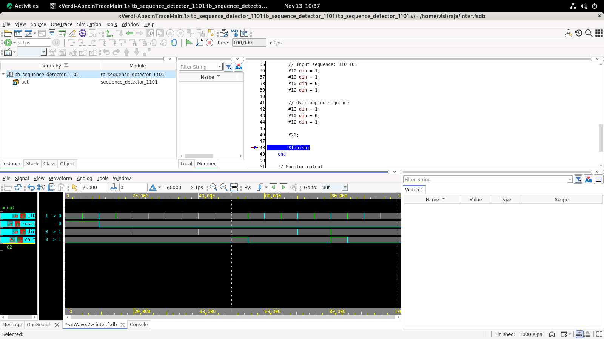

# 🔷 1101 Sequence Detector | Mealy FSM | Verilog HDL

  
  
  
  

---

## 📌 Project Overview

This project implements a **1101 Serial Sequence Detector** using a **Mealy Finite State Machine (FSM)** in Verilog HDL.

The design detects the input pattern `1101` from a serial input stream and supports **overlapping sequence detection**. The project includes RTL design, testbench development, functional simulation using Synopsys VCS, and waveform analysis using Synopsys Verdi.

---

## ⚙️ Design Specifications

| Parameter | Description |
|-----------|-------------|
| **Design** | 1101 Sequence Detector |
| **FSM Model** | Mealy Machine |
| **Number of States** | 4 |
| **Target Sequence** | `1101` |
| **Overlapping Detection** | Supported |
| **Reset** | Asynchronous Active-High |
| **HDL** | Verilog |
| **Simulation** | Synopsys VCS |
| **Waveform Analysis** | Synopsys Verdi |

---

## 🔄 FSM State Transition

| Present State | Input `0` | Input `1` |
|---------------|-----------|-----------|
| **S0** | S0 | S1 |
| **S1** | S0 | S2 |
| **S2** | S3 | S2 |
| **S3** | S0 | S1 → **Output = 1** |

### State Description

- **S0** → No matching bits detected.
- **S1** → First `1` detected.
- **S2** → Sequence `11` detected.
- **S3** → Sequence `110` detected.
- **S3 + Input `1`** → Complete sequence `1101` detected, so output becomes `1`.

Since this is a **Mealy FSM**, the output depends on both the present state and the current input.

---

## 🧠 Sequence Detection

The target sequence is:

`1 → 1 → 0 → 1`

FSM progression:

`S0 --1--> S1 --1--> S2 --0--> S3 --1--> DETECT`

When the final `1` arrives in state `S3`, the output is asserted:

`Output = 1`

The design supports **overlapping detection** by transitioning to `S1` after detecting `1101`. This allows the final `1` of the detected sequence to also serve as the beginning of another possible sequence.

---

## 🧪 Simulation and Verification

### Tools Used

- **Verilog HDL** — RTL Design
- **Synopsys VCS** — Functional Simulation
- **Synopsys Verdi** — Waveform Analysis

### Compile

    vcs -full64 -kdb -debug_access+all sequence_detector.v tb_sequence_detector_1101.v -o simv

### Run Simulation

    ./simv

### Open Waveform

    verdi -dbdir simv.daidir &

---

## 📊 Simulation Waveform

  

  <b>Figure 1: Functional simulation waveform captured using Synopsys Verdi.</b>

---

## 📈 Expected Output

### Input Sequence

    1  1  0  1  1  0  1

### Detected Output

    0  0  0  1  0  0  1

The sequence `1101` is detected twice:

    Input:  1 1 0 1 1 0 1
             └─────┘
               1101
              DETECT

                 1 1 0 1
                 └───────┘
                    1101
                   DETECT

This demonstrates successful **overlapping sequence detection**.

---

## 📁 Repository Structure

    1101-Mealy-Sequence-Detector/
    │
    ├── sequence_detector.v
    ├── tb_sequence_detector_1101.v
    ├── sequence_detector_1101_verdi.png
    └── README.md

---

## 🎯 Learning Outcomes

- Understanding **Mealy FSM architecture**
- Designing state transition logic in Verilog
- Implementing overlapping sequence detection
- Writing Verilog RTL and testbenches
- Performing functional simulation using **Synopsys VCS**
- Debugging RTL using **Synopsys Verdi**
- Analyzing digital waveforms
- Understanding practical RTL verification flow

---

## 🚀 Future Improvements

- Parameterized sequence detector for arbitrary patterns
- Moore FSM implementation for comparison
- Multiple sequence pattern detection
- SystemVerilog assertions
- Functional and code coverage
- RTL synthesis and PPA analysis
- Timing analysis
- RTL-to-GDSII implementation

---

  <b>Designed and Simulated using Verilog HDL</b>
   
  <i>Digital Design | Finite State Machines | RTL Verification</i>

